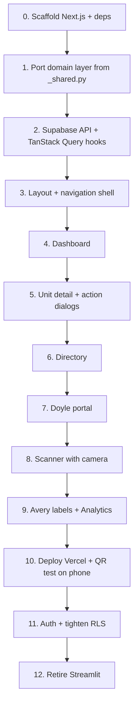

# PTAC Pro Tracker — React / Next.js Implementation Guide

This document describes how to rebuild PTAC Pro Tracker without Streamlit. The existing Python app (`app.py`, `views/*.py`) is the **reference implementation**. Supabase stays the backend. The new frontend is a **Next.js (React) app** deployed on **Vercel**.

---

## Goals

| Keep | Replace |
|------|---------|
| Supabase database, tables, and RLS | Streamlit UI and Python view layer |
| Business rules in `views/_shared.py` (ported to TypeScript) | `st.session_state`, full-page reruns |
| QR deep links to unit detail | Streamlit query-param + inline overlay pattern |
| Hotel ops + Doyle contractor workflows | Streamlit segmented navigation |

**Why not Streamlit on Vercel:** Streamlit needs a persistent Python process and WebSockets. Vercel is built for serverless Node.js/React. A React frontend on Vercel talking directly to Supabase is the correct architecture.

---

## Target Stack

| Layer | Tool | Purpose |
|-------|------|---------|
| Framework | **Next.js 15+** (App Router) | Routing, layouts, SSR where useful |
| Language | **TypeScript** | Type-safe port of Python helpers |
| UI | **React 19** | Components, hooks, client interactivity |
| Styling | **Tailwind CSS v4** | Utility classes; theme via `@theme` in `globals.css` (v4 has no `tailwind.config.ts`) |
| Components | **shadcn/ui** (Radix primitives) | Dialogs, forms, tables, buttons |
| Data fetching | **TanStack Query** | Live reads + cache invalidation after writes |
| Forms | **react-hook-form** + **Zod** | Custody, PM, repair, Doyle forms |
| Database client | **@supabase/supabase-js** | Same PostgREST access as `supabase-py` |
| QR generation | **qrcode** npm package or `api.qrserver.com` | Label and unit-detail QR codes |
| QR scanning | **html5-qrcode** | Browser camera decode (major upgrade) |
| Hosting | **Vercel** | Production + preview deploys |
| Auth (phase 2) | **Supabase Auth** | Hotel staff vs Doyle contractor |

---

## Repository Layout

Add a `web/` directory alongside the existing Streamlit code. Keep Streamlit during migration as a reference; remove it once feature parity is reached.

```
PTAC/
├── web/                              # NEW — Next.js app
│   ├── app/
│   │   ├── layout.tsx                # Root shell, nav (server component)
│   │   ├── providers.tsx             # "use client" — TanStack Query provider
│   │   ├── globals.css               # Tailwind v4 @theme tokens
│   │   ├── page.tsx                  # Redirect → /dashboard
│   │   ├── dashboard/page.tsx
│   │   ├── directory/page.tsx
│   │   ├── scanner/page.tsx
│   │   ├── labels/page.tsx           # Avery labels
│   │   ├── analytics/page.tsx
│   │   ├── units/[ptacId]/page.tsx   # Unit detail (replaces hidden overlay)
│   │   └── doyle/page.tsx            # Contractor portal
│   ├── components/
│   │   ├── layout/
│   │   │   ├── app-header.tsx
│   │   │   ├── category-nav.tsx      # Hotel Ops vs Contractor
│   │   │   └── sub-nav.tsx
│   │   ├── dashboard/
│   │   │   ├── kpi-cards.tsx
│   │   │   ├── floor-grid.tsx
│   │   │   └── unit-tile.tsx
│   │   ├── directory/
│   │   │   ├── inventory-table.tsx
│   │   │   └── spare-registration-form.tsx
│   │   ├── units/
│   │   │   ├── unit-detail-header.tsx
│   │   │   ├── custody-transfer-dialog.tsx
│   │   │   ├── pm-dialog.tsx
│   │   │   ├── onsite-repair-dialog.tsx
│   │   │   └── history-feed.tsx
│   │   ├── doyle/
│   │   │   ├── repair-queue.tsx
│   │   │   └── completion-form.tsx
│   │   ├── labels/
│   │   │   └── avery-sheet.tsx
│   │   └── ui/                       # shadcn components
│   ├── lib/
│   │   ├── supabase/
│   │   │   ├── client.ts             # Browser client
│   │   │   └── server.ts             # Optional server client
│   │   ├── domain/
│   │   │   ├── constants.ts          # FLOORS, ROOM_SUFFIXES, STATUSES
│   │   │   ├── locations.ts          # room_options, infer_location_type
│   │   │   ├── display.ts            # display_status, btu_from_model
│   │   │   └── urls.ts               # unitDetailUrl, parseScanLookup
│   │   ├── api/
│   │   │   ├── units.ts              # fetchUnits, fetchUnit, updateUnitLocation
│   │   │   ├── logs.ts               # PM, transfers, repairs
│   │   │   └── doyle.ts              # completeDoyleRepair
│   │   └── hooks/
│   │       ├── use-units.ts
│   │       ├── use-unit.ts
│   │       └── use-unit-mutations.ts
│   ├── types/
│   │   └── database.ts               # Generated from Supabase schema
│   ├── .env.local.example
│   ├── next.config.ts
│   └── package.json
├── supabase/                         # UNCHANGED
│   └── rls_policies.sql
├── views/                            # REFERENCE ONLY during migration
└── Implementation.md                 # This file
```

---

## Phase 0 — Scaffold the App

### 1. Create the Next.js project

From the repo root:

```bash
npx create-next-app@latest web \
  --typescript \
  --tailwind \
  --eslint \
  --app \
  --no-src-dir \
  --import-alias "@/*"

cd web
npx shadcn@latest init
```

When prompted, use these defaults:
- Style: **New York**
- Base color: **Slate**
- CSS variables: **Yes**

Add core shadcn components:

```bash
npx shadcn@latest add button dialog form input select table tabs badge checkbox card separator sonner
```

### 2. Install dependencies

```bash
npm install @supabase/supabase-js @tanstack/react-query react-hook-form @hookform/resolvers zod html5-qrcode qrcode date-fns
npm install -D @types/qrcode
npm install -D supabase   # CLI for type generation (optional)
```

### 3. Environment variables

Create `web/.env.local`:

```env
NEXT_PUBLIC_SUPABASE_URL=https://YOUR-PROJECT.supabase.co
NEXT_PUBLIC_SUPABASE_ANON_KEY=YOUR_ANON_KEY
NEXT_PUBLIC_APP_URL=http://localhost:3000
```

On Vercel, set the same variables in **Project → Settings → Environment Variables**. `NEXT_PUBLIC_APP_URL` becomes your production domain (e.g. `https://ptac-tracker.vercel.app`).

### 4. Supabase client

`web/lib/supabase/client.ts`:

```typescript
import { createClient } from "@supabase/supabase-js";

// Module-level singleton — one client per browser session,
// same role as st.session_state.supabase in app.py.
export const supabase = createClient(
  process.env.NEXT_PUBLIC_SUPABASE_URL!,
  process.env.NEXT_PUBLIC_SUPABASE_ANON_KEY!
);
```

Note: `createBrowserClient` lives in the separate `@supabase/ssr` package, not `@supabase/supabase-js`. Plain `createClient` is correct for this MVP (anon key, no auth, all data fetching from client components). When Phase 9 adds Supabase Auth with middleware-protected routes, switch to `@supabase/ssr` so sessions sync between server and browser via cookies.

### 5. TanStack Query provider

Do **not** put `"use client"` on the root layout — it must stay a server component (metadata, `<html>`/`<body>`). Instead, create a client-side provider component and render it inside the layout.

`web/app/providers.tsx`:

```typescript
"use client";
import { useState } from "react";
import { QueryClient, QueryClientProvider } from "@tanstack/react-query";

export function Providers({ children }: { children: React.ReactNode }) {
  // useState ensures one client per mount, safe across React strict-mode re-renders
  const [queryClient] = useState(
    () =>
      new QueryClient({
        defaultOptions: {
          queries: {
            staleTime: 0,        // Match Streamlit: live reads, no stale cache
            refetchOnWindowFocus: true,
          },
        },
      })
  );

  return <QueryClientProvider client={queryClient}>{children}</QueryClientProvider>;
}
```

`web/app/layout.tsx` (stays a server component):

```typescript
import { Providers } from "./providers";

export default function RootLayout({ children }: { children: React.ReactNode }) {
  return (
    <html lang="en">
      <body>
        <Providers>{children}</Providers>
      </body>
    </html>
  );
}
```

This mirrors the intentional **no caching** behavior in `views/_shared.py`.

---

## Phase 1 — Port the Domain Layer

Port `views/_shared.py` to TypeScript before building UI. Every page depends on these helpers.

### Constants (`lib/domain/constants.ts`)

Port directly from Python:

```typescript
export const STATUSES = ["Active", "Needs PM", "Maintenance Office", "Doyle Shop"] as const;
export const LOCATION_TYPES = ["Room", "Hallway", "Elevator Closet", "Maintenance Office", "Doyle Shop", "Spare"] as const;
export const FLOORS = [2, 3, 4, 5, 6] as const;
export const ROOM_SUFFIXES = [3, 4, 5, 6, 7, 8, 9, 10, 11, 12, 14, 15, 16, 17, 18, 19, 20, 21, 22, 24, 25, 26, 27, 28, 29] as const;
```

### Location helpers (`lib/domain/locations.ts`)

Port these functions one-to-one:

| Python (`_shared.py`) | TypeScript |
|-----------------------|------------|
| `room_options()` | `roomOptions()` |
| `corridor_options()` | `corridorOptions()` |
| `location_options()` | `locationOptions()` |
| `infer_location_type()` | `inferLocationType()` |
| `target_status_for_location()` | `targetStatusForLocation()` |
| `active_unit_at_location()` | `activeUnitAtLocation()` |
| `next_ptac_id()` | `nextPtacId()` |
| `allowed_transfer_paths()` *(in `unit_detail.py`)* | `allowedTransferPaths()` |
| `resolve_target_location()` *(in `unit_detail.py`)* | `resolveTargetLocation()` |
| `doyle_repair_cost()` | `doyleRepairCost()` |
| `latest_doyle_dispatch_note()` | `latestDoyleDispatchNote()` |

**`allowedTransferPaths()` and `resolveTargetLocation()` encode hotel operational policy** (which destinations are legal from each unit state, and that "Spare Storage" resolves to `"5th Floor Storage Closet"`). They live in `views/unit_detail.py`, not `_shared.py` — don't miss them, and port the rules exactly.

### Display helpers (`lib/domain/display.ts`)

| Python | TypeScript |
|--------|------------|
| `display_status()` | `displayStatus()` |
| `btu_from_model()` | `btuFromModel()` |
| `short_btu_from_model()` | `shortBtuFromModel()` |
| `dashboard_status_style()` | `dashboardStatusClasses()` — return Tailwind class strings instead of inline CSS |
| `is_at_maintenance_office()` | `isAtMaintenanceOffice()` |

Map status colors from `DESIGN_SYSTEM.md`:

```typescript
export const STATUS_STYLES: Record<string, string> = {
  Active: "bg-green-50 border-green-200 text-green-800",
  "Needs PM": "bg-amber-50 border-amber-200 text-amber-800 animate-pulse",
  "Maintenance Office": "bg-violet-50 border-violet-200 text-violet-800",
  "Doyle Shop": "bg-rose-50 border-rose-200 text-rose-800",
  "Spare/Storage": "bg-blue-50 border-blue-200 text-blue-800",
  Unknown: "bg-slate-50 border-dashed border-slate-300 text-slate-500",
};
```

These match the hex values in `dashboard_status_style()` (`_shared.py`). Unknown/empty rooms use the dashed-border style.

### URL helpers (`lib/domain/urls.ts`)

Replace Streamlit's `app_base_url()` and `unit_detail_url()`:

```typescript
export function appBaseUrl(): string {
  if (typeof window !== "undefined") {
    return window.location.origin;
  }
  return process.env.NEXT_PUBLIC_APP_URL ?? "http://localhost:3000";
}

export function unitDetailUrl(ptacId: string): string {
  return `${appBaseUrl()}/units/${encodeURIComponent(ptacId)}`;
}

// Port parse_scan_lookup() — accept a plain PTAC ID, a new /units/ URL,
// or a legacy ?unit_detail= URL. The URL constructor throws on malformed
// input, so wrap it — bad input should fall through, never crash the scanner.
export function parseScanLookup(raw: string): string | null {
  const text = raw.trim();
  if (!text) return null;

  try {
    const url = text.includes("://") ? new URL(text) : new URL(text, "http://local");

    // New format: /units/PTAC-001
    const unitsMatch = url.pathname.match(/\/units\/([^/]+)/);
    if (unitsMatch) return decodeURIComponent(unitsMatch[1]).trim().toUpperCase();

    // Legacy Streamlit format: ?unit_detail=PTAC-001
    const id = url.searchParams.get("unit_detail");
    if (id) return id.trim().toUpperCase();
  } catch {
    // Not a URL — treat as a raw PTAC ID below
  }

  return text.toUpperCase();
}
```

**QR URL change:** Old Streamlit links used `?unit_detail=PTAC-001`. New links use `/units/PTAC-001`. Keep `parseScanLookup()` accepting both formats so existing printed labels still work.

---

## Phase 2 — Data Access Layer

Port Supabase operations from `_shared.py` into `web/lib/api/`.

### Read operations

| Python | TypeScript | Query key |
|--------|------------|-----------|
| `fetch_units()` | `fetchUnits()` | `["units"]` |
| `fetch_unit(id)` | `fetchUnit(ptacId)` | `["units", ptacId]` |
| `fetch_pm_logs(id?)` | `fetchPmLogs(ptacId?)` | `["pm_logs", ptacId]` |
| `fetch_transfers(id?)` | `fetchTransfers(ptacId?)` | `["transfers", ptacId]` |
| `fetch_onsite_repairs(id?)` | `fetchOnsiteRepairs(ptacId?)` | `["onsite_repairs", ptacId]` |
| `fetch_doyle_repairs(id?)` | `fetchDoyleRepairs(ptacId?)` | `["doyle_repairs", ptacId]` |

Example:

```typescript
export async function fetchUnits(supabase: SupabaseClient) {
  const { data, error } = await supabase
    .from("ptac_units")
    .select("ptac_id, serial_number, model_specs, current_location_name, location_type, status, last_pm_date, created_at")
    .order("ptac_id");

  if (error) throw error;
  return data ?? [];
}
```

### Write operations

Port these with identical table contracts (see `ARCHITECTURE.md`):

| Python | TypeScript | Invalidates |
|--------|------------|-------------|
| `update_unit_location()` | `updateUnitLocation()` | `["units"]`, `["transfers"]` |
| `register_pm_log()` | `registerPmLog()` | `["units"]`, `["pm_logs"]` |
| `register_onsite_repair()` | `registerOnsiteRepair()` | `["onsite_repairs"]` |
| `complete_doyle_repair()` | `completeDoyleRepair()` | `["units"]`, `["transfers"]`, `["doyle_repairs"]` |

**Important:** `complete_doyle_repair()` in Python handles occupied-room displacement by calling `update_unit_location()` on the occupying unit first. Port this logic exactly — do not simplify.

Use TanStack Query mutations:

```typescript
const mutation = useMutation({
  mutationFn: (input) => updateUnitLocation(supabase, input),
  onSuccess: () => {
    queryClient.invalidateQueries({ queryKey: ["units"] });
    queryClient.invalidateQueries({ queryKey: ["transfers"] });
  },
});
```

### Types

Generate Supabase types for autocomplete and safety:

```bash
npx supabase gen types typescript --project-id YOUR_PROJECT_ID > web/types/database.ts
```

Or define minimal interfaces manually matching `ARCHITECTURE.md` schema tables.

---

## Phase 3 — Routing and Navigation

### Route map

| Streamlit | Next.js route | Notes |
|-----------|---------------|-------|
| `views/dashboard.py` | `/dashboard` | Default landing page |
| `views/directory.py` | `/directory` | Inventory table |
| `views/scanner.py` | `/scanner` | Camera + manual lookup |
| `views/avery.py` | `/labels` | Print Avery sheets |
| `views/analytics.py` | `/analytics` | Spending & PM audits |
| `views/doyle.py` | `/doyle` | Contractor portal |
| `views/unit_detail.py` | `/units/[ptacId]` | Dedicated page, not overlay |
| `app.py` `?unit_detail=` | `/units/[ptacId]` or redirect | Legacy QR support |

### Navigation shell

Replace Streamlit's two-level segmented controls (`app.py`) with a shared layout:

```
┌─────────────────────────────────────────────────────────────┐
│ 🏨 PTAC Pro Tracker          [Hotel Ops] [Contractor]     │
├─────────────────────────────────────────────────────────────┤
│ Dashboard │ Directory │ Scanner │ Labels │ Analytics        │  ← Hotel Ops
│ (or: Doyle Portal only)                                     │  ← Contractor
├─────────────────────────────────────────────────────────────┤
│ {children — page content}                                   │
└─────────────────────────────────────────────────────────────┘
```

Implementation:
- `app/layout.tsx` — header + category toggle
- `components/layout/sub-nav.tsx` — sub-routes per category
- Use Next.js `<Link>` for navigation; no manual "clear unit detail" needed because unit detail is its own route

### Unit detail: route instead of overlay

Streamlit renders unit detail inline when `selected_ptac_id` is set. In React, use a **dedicated route**:

- Dashboard tile click → `router.push("/units/PTAC-001")`
- Directory "View / Action" → same
- Scanner match → same
- QR scan → opens `/units/PTAC-001` directly

This eliminates `clear_unit_detail_selection()` — leaving unit detail is just navigating away.

---

## Phase 4 — Page Implementation

Build pages in this order (highest operational value first).

### 4.1 Dashboard (`/dashboard`)

**Reference:** `views/dashboard.py`

Components:
- **KPI cards** — total inventory, active, PM overdue, maintenance office, Doyle shop
- **Floor grid** — floors 2–6, room tiles, suite 211 split (A/B)
- **Support sections** — hallways, elevator closet, maintenance office, Doyle shop, spare storage
- **Unit tiles** — link to `/units/[ptacId]`, show PTAC ID, location, BTU label, status color

Data: `useQuery({ queryKey: ["units"], queryFn: () => fetchUnits(supabase) })`

Group units by floor and location using the same logic as the Python dashboard (filter by `current_location_name` patterns).

### 4.2 Unit detail (`/units/[ptacId]`)

**Reference:** `views/unit_detail.py`

This is the core action surface. Build as a client component page.

Sections:
1. **Header** — PTAC ID, serial, model, BTU, current location, status badge
2. **QR code** — encode `unitDetailUrl(ptacId)` using qrcode library or QR API
3. **Action cards** — open dialogs for:
   - Custody transfer
   - Register routine PM
   - Log onsite repair
4. **Header buttons** — two more dialogs the Streamlit app has (`render_edit_form`, `render_delete_form`):
   - Edit specs (serial number, model specs)
   - Delete unit (confirmation required)
5. **History feed** — merged custody transfers, PM logs, onsite repairs, Doyle repairs, and the unit's `created_at` install event, sorted newest first (port `fetch_history()` from `unit_detail.py`)

#### Custody transfer dialog

**Critical UX pattern from Streamlit:** destination type selector and dependent dropdowns must update **immediately** when the user changes route (Guest Room vs Corridor vs fixed location). In React this is natural — use controlled state, not form isolation.

Flow:
1. Route options come from `allowedTransferPaths(unit)` — they depend on the unit's current state, not a fixed list. E.g. a unit at Doyle Shop can only go to Spare Storage, Guest Room, or Maintenance Office.
2. Show dependent dropdown for Guest Room (room list) or Corridor/Hallway (hallway list); other routes resolve directly via `resolveTargetLocation()`
3. Check `activeUnitAtLocation()` — if occupied, show override checkbox
4. Require technician name (not prefilled)
5. Submit → `updateUnitLocation()`; if override was used, first displace the occupying unit to Maintenance Office with a logged note (same as Python)

Zod schema example:

```typescript
const custodySchema = z.object({
  // Route values match allowed_transfer_paths() categories
  route: z.enum(["Guest Room", "Corridor/Hallway", "Elevator Closet", "Spare Storage", "Maintenance Office", "Doyle Shop"]),
  roomChoice: z.string().optional(),
  corridorChoice: z.string().optional(),
  technician: z.string().min(1, "Technician name is required"),
  notes: z.string().optional(),
  overrideOccupied: z.boolean().optional(),
});
```

#### PM dialog

- Checkbox tasks: filters, coils, wiring, blower (match `pm_logs` columns) — **all 4 required** before submit
- Technician + notes
- If the unit is not at Maintenance Office, move it there first via `updateUnitLocation()` (same as `render_pm_form` in Python)
- On submit: insert `pm_logs`, update `ptac_units.last_pm_date`
- Unit stays at Maintenance Office after PM; redeploy via a separate custody transfer

#### Onsite repair dialog

- Parts replaced, total repair cost, technician, notes
- If unit not at maintenance office, optionally move it first (match `unit_detail.py` behavior)

### 4.3 Directory (`/directory`)

**Reference:** `views/directory.py`

- Searchable, filterable table (shadcn `Table` + client-side filter, or server filter later)
- Columns: ID, specs/serial, location, status, last PM, actions
- Spare registration form → calls `nextPtacId()` + insert into `ptac_units`
- "View / Action" links to `/units/[ptacId]`

Preserve the polished directory styling from `DESIGN_SYSTEM.md` (uppercase labels, status pills).

### 4.4 Doyle portal (`/doyle`)

**Reference:** `views/doyle.py`

Contractor-isolated layout (dark header, no hotel KPIs).

Left panel:
- Queue of units where `location_type === "Doyle Shop"` or `status === "Doyle Shop"`
- Show PTAC ID, serial, BTU, dispatch note from `latestDoyleDispatchNote()`

Right panel:
- Selected unit banner
- Component checklist + extra parts field
- Total Repair Bill ($) — single field
- Custody route: spare storage or guest room dropdown
- Occupied-room override checkbox (outside submit — visible when room selected)
- Actions: Clear Card, Mark Fixed & Ship to Hotel

Submit → `completeDoyleRepair()` with full displacement logic.

### 4.5 Scanner (`/scanner`)

**Reference:** `views/scanner.py`

Two input modes:
1. **Camera** — `html5-qrcode` scanning decoded URL or PTAC ID
2. **Manual** — text input + submit

On match:
```typescript
const ptacId = parseScanLookup(raw);
if (ptacId) router.push(`/units/${ptacId}`);
```

Do **not** duplicate custody/PM/repair forms here. Scanner is lookup-only.

### 4.6 Avery labels (`/labels`)

**Reference:** `views/avery.py`

- Multi-select units with batch filters (all, maintenance office, Doyle shop)
- Select all / clear selection
- 2×5 sheet preview per page (10 labels)
- Each label: PTAC ID, location, QR encoding `unitDetailUrl(ptacId)`
- Print CSS via `@media print` or dedicated print layout component

### 4.7 Analytics (`/analytics`)

**Reference:** `views/analytics.py`

- KPI row: total spend, avg repair cost, PM count, active Doyle units
- Highest-cost repairs table — PTAC IDs link to `/units/[id]`
- Doyle queue — clickable IDs
- Recent PM log table
- Optional: date range filter (30/90 days)

---

## Phase 5 — Forms and Validation

**As built:** every dialog uses controlled React state with inline validation at
submit (toast error + early return), mirroring the `st.error()` + early-return flow
in the Python views one-to-one. react-hook-form/Zod were dropped — all the forms
have dynamic dependent fields (route → dropdown → occupancy check) where controlled
state is the natural fit, and the error messages are ported verbatim from Python.

Validation rules preserved from Python:
- Technician name required on all write actions (never prefilled)
- All 4 PM checklist tasks must be checked before submit
- Occupied-room override required when `activeUnitAtLocation()` returns a unit
- Doyle completion requires technician, invoice, total bill, target location
- Spare registration requires serial and model specs

Error handling: Supabase errors surface as toast notifications (add shadcn `sonner` toast).

---

## Phase 6 — QR Workflow

### Generating QR codes

Replace external API or use client-side generation:

```typescript
import QRCode from "qrcode";

const dataUrl = await QRCode.toDataURL(unitDetailUrl(ptacId), { width: 200 });
```

Use in unit detail page and Avery label sheets.

### Scanning QR codes

`html5-qrcode` touches `window`/DOM at import time, so it will crash Next.js server rendering if imported at the top of a page. Load it client-side only — either a dynamic import inside `useEffect`, or wrap the scanner component with `next/dynamic` and `ssr: false`:

```typescript
"use client";
import { useEffect } from "react";

useEffect(() => {
  let scanner: import("html5-qrcode").Html5QrcodeScanner | undefined;
  import("html5-qrcode").then(({ Html5QrcodeScanner }) => {
    scanner = new Html5QrcodeScanner("qr-reader", { fps: 10, qrbox: 250 }, false);
    scanner.render((decodedText) => {
      const ptacId = parseScanLookup(decodedText);
      if (ptacId) router.push(`/units/${ptacId}`);
    }, () => {});
  });
  return () => { scanner?.clear(); };
}, []);
```

Request camera permission on mobile. Camera access requires HTTPS, which Vercel provides — a major improvement over Streamlit.

### Legacy label support

Printed labels from the old Streamlit app encode `?unit_detail=PTAC-001`. `parseScanLookup()` must continue accepting that format and redirect to `/units/PTAC-001`.

---

## Phase 7 — Design System Port

Reference `DESIGN_SYSTEM.md` for exact colors and typography.

`create-next-app` scaffolds **Tailwind v4**, which is configured in CSS — there is no `tailwind.config.ts`. Add custom tokens via `@theme` in `app/globals.css`:

```css
@import "tailwindcss";

@theme {
  --color-brand: #2563eb;
  --color-navy: #0f172a;
}
```

This generates utilities like `bg-brand` and `text-navy` automatically.

In practice you barely need custom tokens: every status color in `dashboard_status_style()` maps to a standard Tailwind palette class (green/amber/violet/rose/blue/slate — see `STATUS_STYLES` in Phase 1), so prefer those over custom variables.

Key patterns:
- Cards: white background, `rounded-2xl`, subtle border `#e2e8f0`
- KPI values: `text-4xl font-black`
- Status tiles: colored backgrounds with matching borders
- Needs PM: Tailwind `animate-pulse`
- Doyle portal: dark contractor header, isolated from hotel nav styling

---

## Phase 8 — Deploy on Vercel

### 1. Connect repository

- Import the GitHub repo in Vercel
- Set **Root Directory** to `web`
- Framework preset: **Next.js**

### 2. Environment variables

| Variable | Example |
|----------|---------|
| `NEXT_PUBLIC_SUPABASE_URL` | `https://xxx.supabase.co` |
| `NEXT_PUBLIC_SUPABASE_ANON_KEY` | `eyJ...` |
| `NEXT_PUBLIC_APP_URL` | `https://ptac-tracker.vercel.app` |

### 3. Supabase RLS

Ensure `supabase/rls_policies.sql` has been run. The anon key works from the browser the same way Streamlit's Python client works today.

Before public launch, tighten RLS and add Supabase Auth (see Phase 9).

### 4. Custom domain (optional)

Add a hotel subdomain in Vercel → Domains. Update `NEXT_PUBLIC_APP_URL` to match. Reprint Avery labels with the new base URL.

### 5. Preview deploys

Every PR gets a preview URL automatically — useful for testing Doyle portal changes without affecting production.

---

## Phase 9 — Authentication (post-MVP)

Current Streamlit app has no auth (permissive RLS). Before wide public exposure:

1. Enable **Supabase Auth** (email/password or magic link)
2. Add login page at `/login`
3. Protect routes with middleware:

```typescript
// middleware.ts
export async function middleware(request: NextRequest) {
  // Check Supabase session; redirect unauthenticated users to /login
}
```

4. Update RLS policies:
   - Hotel staff: full read/write on all tables
   - Doyle contractor: read units at Doyle shop; write `doyle_repairs` and related transfers only
5. Pass authenticated user's JWT to Supabase client so RLS can use `auth.uid()`

---

## Phase 10 — Retire Streamlit

Once the React app reaches feature parity:

| Retire | Keep |
|--------|------|
| `app.py` | `supabase/rls_policies.sql` |
| `views/*.py` | `ARCHITECTURE.md`, `DESIGN_SYSTEM.md` (reference) |
| `requirements.txt` | `seed.py` (data bootstrap, if kept in repo) |
| `.streamlit/` | Documentation package |

Update `README.md` to point to `web/` for install and run instructions:

```bash
cd web
npm install
cp .env.local.example .env.local
npm run dev
```

Archive or delete Streamlit-specific deployment docs.

---

## Build Order Summary



---

## Acceptance Criteria

The React app is ready to replace Streamlit when:

- [ ] All ~130 units visible on dashboard floor grid with correct status colors
- [ ] Custody transfer writes to `custody_transfers` and updates `ptac_units`
- [ ] PM log writes to `pm_logs` and updates `last_pm_date`
- [ ] Onsite repair writes to `onsite_repairs`
- [ ] Doyle completion handles occupied-room override
- [ ] Phone camera scan of printed label opens correct unit detail on Vercel URL
- [ ] Legacy `?unit_detail=` QR URLs still resolve
- [ ] Avery label print produces scannable codes pointing to production URL
- [ ] Custody transfer route options follow `allowedTransferPaths()` per unit state
- [ ] Edit specs and delete unit work from the unit detail header
- [ ] Directory spare registration creates new `PTAC-###` rows
- [ ] Analytics links drill down to unit detail

---

## Reference Files

When implementing each area, read the Streamlit source first:

| Area | Primary reference |
|------|-------------------|
| Data layer | `views/_shared.py` |
| Navigation | `app.py` |
| Dashboard | `views/dashboard.py` |
| Unit actions | `views/unit_detail.py` |
| Directory | `views/directory.py` |
| Doyle | `views/doyle.py` |
| Scanner | `views/scanner.py` |
| Labels | `views/avery.py` |
| Analytics | `views/analytics.py` |
| Schema | `ARCHITECTURE.md` |
| Colors / typography | `DESIGN_SYSTEM.md` |
| RLS | `supabase/rls_policies.sql` |

---

## Local Development Commands

```bash
# React app (new)
cd web && npm run dev          # http://localhost:3000

# Streamlit app (reference only, during migration)
streamlit run app.py           # http://localhost:8501
```

Both can run simultaneously against the same Supabase project for side-by-side comparison.
